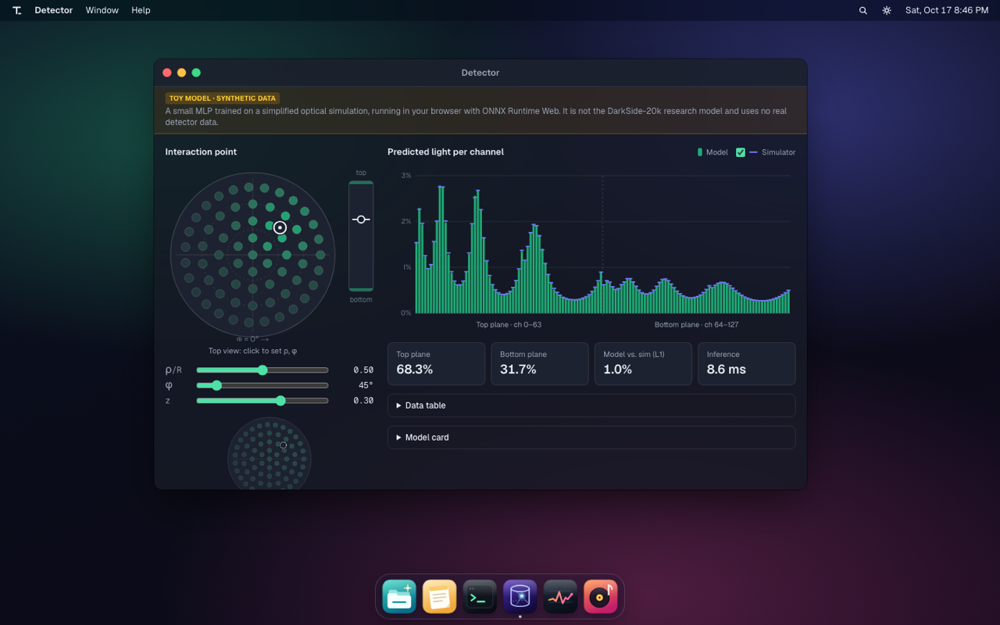
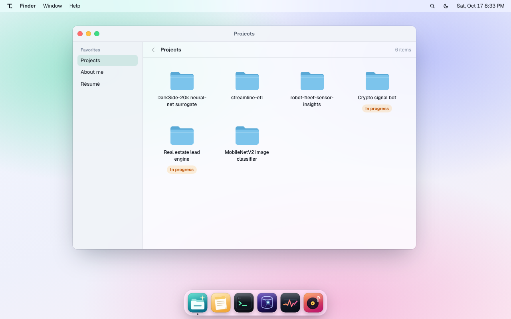
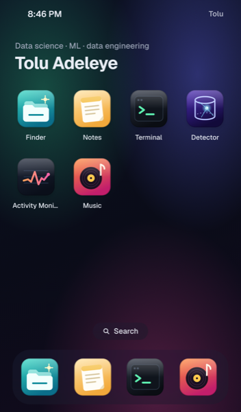
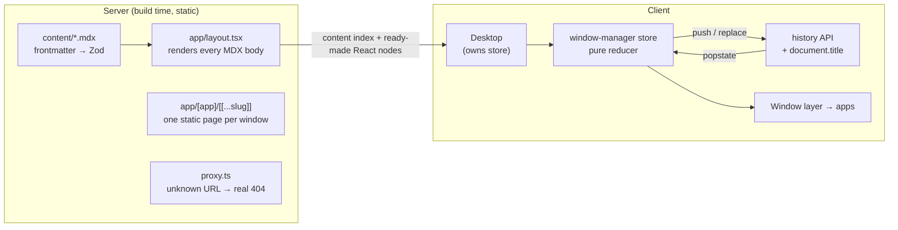

# Tolu Adeleye: portfolio desktop

A personal site built as a desktop in the browser. Windows can be dragged and resized, there's a dock, a ⌘K command palette, a real (tiny) shell, and an in-browser ML demo. On phones it becomes an iOS-style home screen. Every window has its own URL, so links are shareable and the Back button works.

I'm a data science grad (UC Riverside, 2026). The site is meant to show how I build software, so it's structured like a production codebase: a pure, tested window manager, typed content, CI on every push, and end-to-end and accessibility tests.



| Light theme                                    | Phone layout                          |
| ---------------------------------------------- | ------------------------------------- |
|  |  |

## Quick start

```bash
pnpm install          # also copies the ONNX Runtime wasm into public/ort/
pnpm dev              # http://localhost:3000
pnpm check            # lint + format + typecheck + unit tests
pnpm build && pnpm test:e2e
```

Node 24 (see `.nvmrc`), pnpm 10. Python is only needed to retrain the model (below).

## Architecture



### The window manager is a pure reducer

`src/lib/wm/reducer.ts` is `(state, action) → state` with no React and no DOM. It handles open/focus/close/minimize/maximize/move/resize, z-order (array order _is_ z-order), focus fallback when windows close, cascading placement, and keeping title bars reachable when the viewport shrinks. Because it's pure, about 30 unit tests cover it without a browser.

The store (`store.ts`) is created **per mounted desktop**, not as a module singleton, so concurrent server renders of different URLs can never share state.

### URLs: the URL names the focused window

`/notes/about-me` means "Notes is focused, showing About me". The store decides how each change hits browser history (`historyModeFor`):

| Change                                      | History        | Why                                             |
| ------------------------------------------- | -------------- | ----------------------------------------------- |
| Open a window, or show a different document | `pushState`    | Back should undo it                             |
| Focus, minimize, close                      | `replaceState` | URL tracks focus without spamming history       |
| Back/forward (`popstate`)                   | none           | It came _from_ history; writing back would loop |

Back to `/` exits the app you were in, the same as leaving an app on a phone. This is all unit-tested in `store.test.ts` and e2e-tested in `e2e/desktop.spec.ts`.

**Why native `history.pushState` instead of `router.push`?** Every document body is already on the page (see below), so switching windows needs no server round trip. Next 16 integrates native history calls with `usePathname`. The real per-URL routes still exist and are statically generated, which gives deep links, crawlable HTML, and per-page `<title>`/OpenGraph tags.

### Content: MDX rendered once, on the server

Each note and project is an `.mdx` file with YAML frontmatter, validated by Zod (`src/content/schema.ts`). Bad frontmatter **fails the build** with the file name and field. The root layout renders every MDX body to React nodes and hands them to the client shell, so:

- windows switch documents instantly,
- the MDX toolchain never ships to the browser,
- a deep link's HTML already contains its content (SEO, no flash).

`slugs.ts` is a dependency-free list of slugs. The MDX registry is typed against it (`satisfies Record<Slug, …>`), and a unit test fails if a file on disk is missing from the registry.

**Status codes.** With Cache Components, a page for an unknown slug would start streaming with a `200` before it could call `notFound()`. `src/proxy.ts` checks the path against the slug list _before_ rendering and rewrites unknown URLs to a static 404, so link checkers and crawlers get a real `404`.

### Shell details

- **Drag/resize** (`useWindowGestures.ts`): pointer capture with a 3px threshold, so double-click-to-maximize still works. During a drag it writes CSS variables straight to the element once per animation frame (no React renders) and commits to the store on release. Windows move with `transform`, which keeps the compositor busy and the layout untouched.
- **Stable DOM order:** windows render in a fixed order and stack with `z-index`, so focusing one never re-parents DOM nodes. Re-parenting would reset scroll, restart iframes, and drop focus.
- **Dock magnification:** cosine falloff around the pointer. The curve is a tested pure function, and resting icon centers are measured once per hover to avoid a feedback loop.
- **Clock:** `useSyncExternalStore` with a `null` server snapshot, aligned to minute boundaries. No hydration mismatch, no layout shift.
- **Theme:** an inline script sets `data-theme` before first paint (stored choice, else OS preference, else dark). Colors are CSS custom properties, so there's no flash.
- **Phone layout:** pure CSS (`max-width: 700px`). The same window state renders full-screen, and a home screen replaces the dock. Nothing is decided in JavaScript at render time, so the server HTML is right for every device.

### Detector: a toy surrogate model in the browser

> **Toy model on synthetic data.** It illustrates the idea behind my DarkSide-20k research (a neural surrogate that replaces slow optical simulation). It is not that model and uses no real detector data.

```
ml/toydetector/sim.py   toy optics: 2 sensor planes × 64 = 128 channels, solid angle × absorption + diffuse floor
ml/train.py             120k simulated events with photon-counting noise → MLP (3→128→128→128→128, SiLU, softmax)
                        → ONNX (torch.export) → public/models/detector-toy.onnx (210 KB)
src/lib/detector/       ONNX Runtime Web (wasm, lazy-loaded) + a TS port of the simulator
```

- **Validation:** the model trains on _noisy_ samples and is scored against the _noise-free_ simulator on 10k held-out events. Mean L1 distance between predicted and true light distributions is ~2.8% (p95 ~10%). The numbers are in `model-card.json` and shown in the app.
- **Parity tests:** `train.py` asserts that ONNX Runtime (Python) matches PyTorch, and writes `golden.json`. In CI, Vitest loads the committed `.onnx` in **ONNX Runtime Web**, the same runtime the browser uses, and checks it reproduces PyTorch's outputs. It also checks that the TS simulator matches the Python one.
- **Loading:** ONNX Runtime's wasm is ~14 MB raw (~3.5 MB compressed), so it's self-hosted under a versioned path (`/ort/<version>/`, cached as immutable) and only loaded when the Detector or `simulate` runs. Until then the chart shows the simulator, so there's always something on screen.
- **Chart:** model bars plus simulator ticks. The two series differ by mark shape, not just color, and the colors were validated for color-vision deficiency in both themes. There's a hover/keyboard tooltip and a data-table view.

Retrain (about a minute on a laptop CPU; fixed seed):

```bash
cd ml && uv run train.py
```

### Terminal

`src/lib/terminal/` is pure and tested: a shell-style tokenizer (quotes, escapes), a flag parser, a virtual filesystem generated from the same content index as Finder and Notes, bash-like Tab completion, and "did you mean" suggestions (Levenshtein). Commands return **effects** (`open`, `simulate`, `theme`, …) instead of touching the UI, so the executor has no side effects and the window applies them. History persists in `localStorage`.

## Accessibility

- Everything works from the keyboard: skip link, arrow keys in the dock, ARIA menu buttons in the menu bar, ⌘K / Ctrl K palette (combobox pattern), `Alt+←↑→↓` to move windows (`+Shift` to resize), `Alt+W/M/F`, `Ctrl+\``, and `?` for the full list.
- Focus moves into a window when it opens and is restored sensibly when it closes. Dialogs use native `<dialog>` for the focus trap.
- `prefers-reduced-motion` turns animations into instant changes and disables dock magnification.
- axe-core runs in e2e on key pages in both themes, failing on any serious or critical issue.

## Testing and CI

| Layer | Tool          | What                                                                                                                                                         |
| ----- | ------------- | ------------------------------------------------------------------------------------------------------------------------------------------------------------ |
| Unit  | Vitest        | window-manager reducer and history policy, routes, content schema/registry, fuzzy search, terminal parser/completion, detector simulator, ONNX parity, proxy |
| E2E   | Playwright    | dock → URL → Back, deep links, dragging, minimize/close, palette, terminal, in-browser inference, 404 status, phone layout, keyboard-only flow               |
| A11y  | axe-core      | key pages in light and dark                                                                                                                                  |
| Perf  | Lighthouse CI | performance (warn < 90), a11y / best practices / SEO (fail < 95)                                                                                             |

GitHub Actions runs lint, Prettier, `tsc`, and unit tests in one job, then build, e2e, and Lighthouse in another, on every push and PR.

Local Lighthouse on the production build: **Performance 100 / Accessibility 100 / Best Practices 100 / SEO 100** on desktop, and Performance 95–97 on emulated mobile.

## Editing content

- **About / résumé:** `src/content/notes/*.mdx`
- **Projects:** `src/content/projects/*.mdx`. To add one, create the file, add its slug to `src/content/slugs.ts`, and import it in `src/content/index.ts`. TypeScript and the tests tell you if you miss a step.
- **Links (résumé PDF, playlist, email):** `src/config/site.ts`. Anything left `null` is hidden rather than rendered as a broken link.
- `<Todo>…</Todo>` renders a highlighted placeholder so unfinished sections stand out.

## Repo layout

```
src/app/            routes, layout, 404, sitemap, robots
src/shell/          Desktop, Window, Dock, MenuBar, CommandPalette, HomeScreen
src/apps/           notes, finder, terminal, detector, activity, music
src/lib/wm/         reducer, store, routes, geometry (+ tests)
src/lib/terminal/   parser, vfs, commands, completion (+ tests)
src/lib/detector/   ONNX loading, simulator port, model card, golden outputs (+ tests)
src/content/        MDX, schema, slug manifest, registry
src/icons/          hand-drawn SVG icons
ml/                 toy simulator and training/export script (uv)
e2e/                Playwright specs
```

All icons, the wallpaper, and the cover art are original SVG/CSS written for this site.

## Deploying

Import the repo in Vercel. It detects Next.js and pnpm, and `postinstall` copies the wasm runtime. Set `NEXT_PUBLIC_SITE_URL` to the production URL so canonical links, the sitemap, and OpenGraph tags use it.
